# axross-amp-android

[axross-amp](https://github.com/c0decave/axross-amp) - axross's media player
with its 69 music visualizations ("faces") - on Android. The player is the
desktop program's own library crate (the engine, the analysis, the faces,
the flash guard), compiled for Android as it is; this repository adds a
touch screen around it and the little Java an Android app cannot do without.

**Status: a pre-release.** One screen, music from a folder or files you
pick, played on in the background and with the screen off, controlled from
the app, the media notification, the lock screen and a headset; the faces
full screen. Tested in emulators by CI (see [What is verified](#what-is-verified));
reports from phones welcome.

**Android 9 (API 28) to 16 (API 36) are supported** and tested in CI's
emulators (API 28, 34, 36); Android 8.0 / 8.1 (API 26 / 27) install and are
run in CI, but are not a promise.

> **Photosensitivity warning.** The visualizations move with the music. They
> are guarded against flashes, red flashes and patterns by the same flash
> guard, with the same limits, as on the desktop (WCAG 2.3.1 / 2.3.2: no
> more than three flashes in any second, no saturated red flash) - it is the
> same code, and nothing in this app turns it off or loosens it. The guard's
> measurements were made for a desktop's screen; a phone held close fills
> more of the view, and they have not been made again for that. The
> pictures are not guaranteed safe for everyone. If you or anyone watching
> has epilepsy or is sensitive to flashing light, do not use them.
> More: [axross-amp's notes on photosensitivity](https://github.com/c0decave/axross-amp/blob/master/docs/FLASH_SAFETY.md).

## What works (as built; to be confirmed on devices)

- **Works offline, fully**: no network permission, no network code (see
  [Privacy](#privacy)).
- **Music from a folder or from files**, picked with Android's own pickers
  (the Storage Access Framework): no storage permission, no network. A
  folder is read with its subfolders (up to 5000 tracks), in a folder's
  natural order. The read permission is kept: at the next start the list,
  the track and where it was are back, paused - nothing to pick again.
- **In the background**: the music plays on with the app hidden, the screen
  off and on the lock screen (a foreground service of the type
  mediaPlayback with a media notification; Android 13+ asks for the
  notification permission at the first play). The notification, the lock
  screen, Android 13's media controls, headsets and Bluetooth have play /
  pause, previous / next, 15 s back / on and the seek bar.
- **Every format the desktop plays**: MP3, FLAC, Ogg Vorbis, Opus (libopus,
  compiled in), AAC / ALAC in MP4, WAV, AIFF, CAF, MKA - decoded by
  symphonia, played through cpal on AAudio, gapless from track to track.
- **All 69 faces**, drawn by wgpu on Vulkan (Android 10 and later with a
  GPU's Vulkan driver) or OpenGL ES 3 (older Android, the emulator), the
  pixel faces by shaders where the GPU does that faster than the CPU.
- **Touch**: swipe left / right for the next / previous face; tap to show or
  hide the controls (on the picture's outer thirds the tap waits 0.3 s for
  a second one); double tap on the left / right third for 10 s back / on
  (more taps skip on); the controls leave by themselves after a few
  seconds of music. The list of faces opens from "Faces".
- **Controls**: title and artist, a seek bar (heard while it is dragged, a
  tap jumps there), previous / 15 s back / play-pause / 15 s on / next -
  hold previous or next to wind, faster the longer - "Folder" and
  "Files". Every target is at least 48 dp.
- **Rotation, cutouts, system bars**: one layout for portrait and landscape,
  drawn edge to edge, the controls kept inside the safe insets.
- **The screen stays on** while music plays.
- **Lifecycle**: when the app is hidden the picture stops (the window's
  surface is given up, made anew when it is shown) and the music plays on;
  paused and hidden for a minute, the sound output is closed until the next
  play. Audio focus: a call or another player pauses the music, a short
  interruption ends where it began; pulling the headphones out pauses.

## What does not work yet

- Swiping the app away from the recent apps ends it, the music too (the
  player lives with the activity's process: see docs/ARCHITECTURE.md).
- No media library (MediaStore), no shuffle or repeat in the screen yet;
  the face is not remembered between starts.
- No equalizer, playlists, internet radio, settings, colour schemes other
  than Classic, or Bluetooth view: the desktop's window is not in the APK,
  only its player.
- The system's "remove animations" setting does not calm the faces yet.
- No TalkBack support: egui's AccessKit bridge needs GameActivity (see
  [docs/ARCHITECTURE.md](docs/ARCHITECTURE.md)).
- 32-bit devices (armeabi-v7a) are not built for.
- A document from a provider whose files cannot be opened in place (some
  cloud storage) is copied into the app's cache before it plays; that takes
  as long as the copy takes.

## Screenshots

Taken by CI in an Android 14 emulator (Pixel 6 profile,
[screenshots.yml](.github/workflows/screenshots.yml)), playing demo music
made up by [a script](scripts/ci/demo_audio.py) - nobody's music, nothing
personal on the screen. The app has one dark look; there is no light theme.
There is no playlist view either: the list is the folder or the files picked.

| The player | With the cover | The list of faces |
|:---:|:---:|:---:|
| 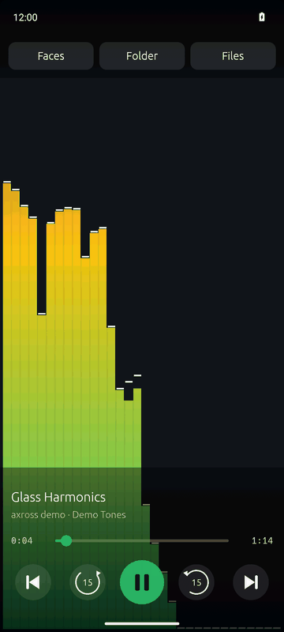 | 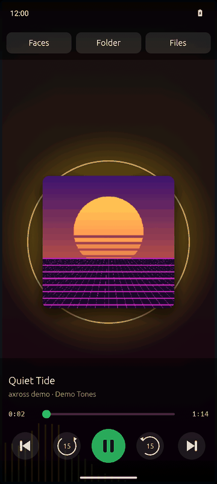 | 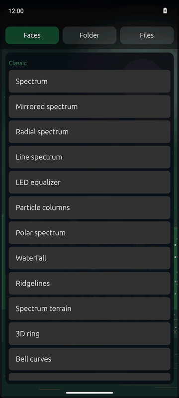 |

| Mirrored spectrum | Radial spectrum | Particle columns |
|:---:|:---:|:---:|
| 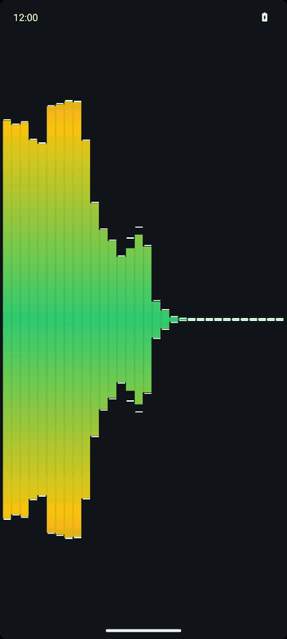 | 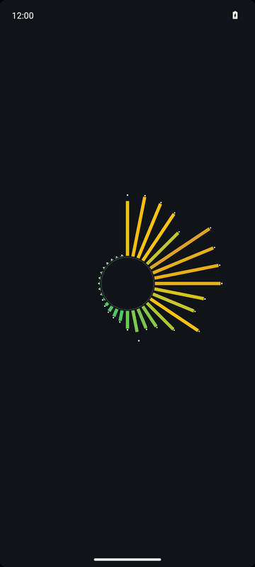 | 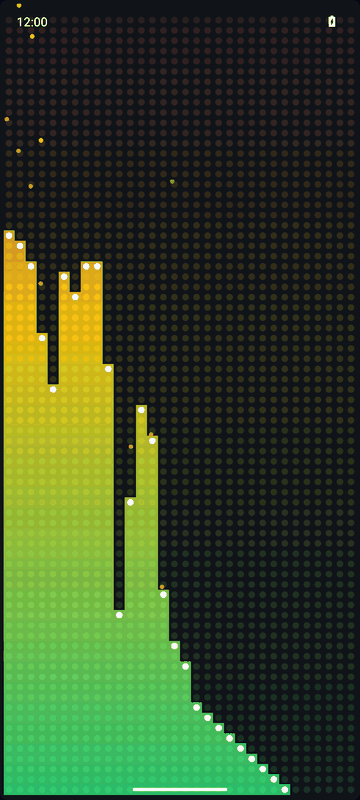 |

| Synthwave | Galaxy | Skyline |
|:---:|:---:|:---:|
| 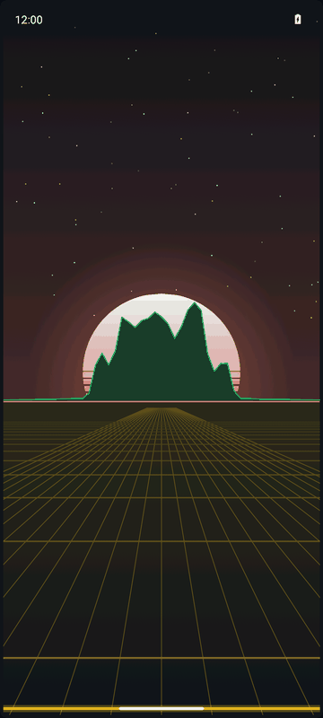 | 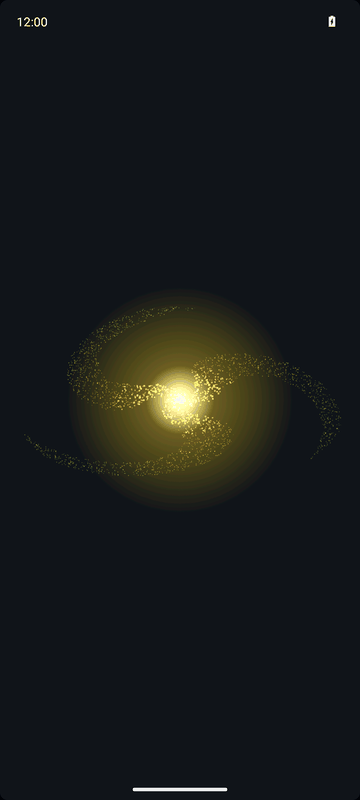 | 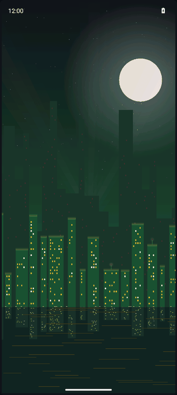 |

| The media notification | The lock screen |
|:---:|:---:|
| 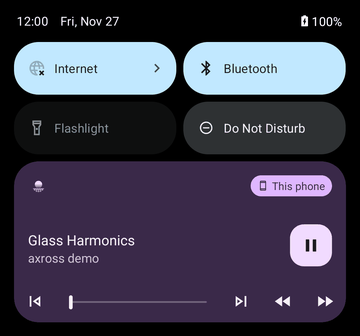 | 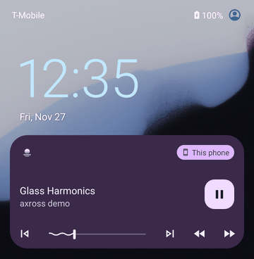 |

On its side:

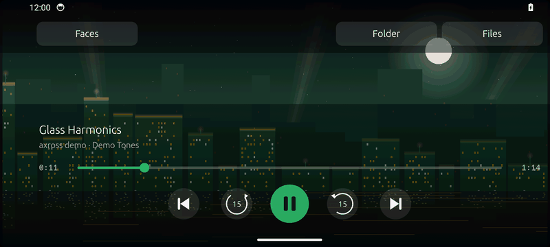

## Install

From the [releases](https://github.com/c0decave/axross-amp-android/releases):
`axross-amp-android-X.Y.Z-arm64-v8a.apk` (arm64 phones, Android 9 or later)
and `SHA256SUMS`. Check the APK before you install it:

```sh
sha256sum -c SHA256SUMS                       # "...apk: OK"
apksigner verify --print-certs axross-amp-android-*-arm64-v8a.apk
# Signer #1 certificate SHA-256 digest:
#   914f2e01954356f9a8c463512779cbd2ad21d0de7cb3c6ef068de06426978d2a
```

Then open the APK on the phone (it asks to allow installing from that
source), or with USB debugging on:

```sh
adb install -r axross-amp-android-*-arm64-v8a.apk
```

The releases are pre-releases for now. Every CI run also builds a debug APK
(artifact `axross-amp-android-debug-apk`; arm64-v8a and x86_64), which
installs as `io.github.c0decave.axrossamp.debug`, next to a release
(`io.github.c0decave.axrossamp`):

```sh
adb install -r app-debug.apk
adb shell am start -n io.github.c0decave.axrossamp.debug/io.github.c0decave.axrossamp.MainActivity
adb logcat -s axrossamp          # the app's own lines
```

If the picture stays black on a device, try the other renderer and tell us
which one works:

```sh
adb shell setprop debug.axrossamp.backend gl       # or: vulkan, auto
adb shell am force-stop io.github.c0decave.axrossamp.debug
```

## Permissions

| Permission | Why |
|---|---|
| `FOREGROUND_SERVICE`, `FOREGROUND_SERVICE_MEDIA_PLAYBACK` | the playback service that keeps the music playing with the app hidden or the screen off (Android 9+, 14+) |
| `POST_NOTIFICATIONS` | the media notification with its buttons (Android 13+; asked for at the first play - the lock screen's and quick settings' controls work without it) |

That is all. No storage permission: music comes through Android's pickers,
which hand over only what you pick (the read permission for it is kept, so
the next start finds it again). **No network permission** - not INTERNET,
not even the network's state.

## Privacy

Nothing leaves the phone. The app has no network permission and no
network code: no update check, no telemetry, no crash reporting, no
cover or lyrics lookup, no fonts or anything else downloaded - Android does
not even let it open a socket. It works the same in airplane mode. What it
keeps (the list picked last, the track and where it was) stays in its own
files on the phone and goes with the app when it is uninstalled. CI checks
it on every build: no HTTP or TLS crate in what is compiled for Android, no
network permission in the APK, and the emulator's tests run in airplane
mode with the app's process outside Android's network group.

## Build

You need: Rust (stable) with the targets `aarch64-linux-android` and
`x86_64-linux-android`, [cargo-ndk](https://github.com/bbqsrc/cargo-ndk)
4.1.2, CMake, JDK 17, Gradle 8.14.x, the Android SDK (platform 36) and the
NDK named in `android/gradle.properties` (`amp.ndkVersion`), with
`ANDROID_HOME` and `ANDROID_NDK_HOME` set.

```sh
git clone --recurse-submodules https://github.com/c0decave/axross-amp-android
cd axross-amp-android
rustup target add aarch64-linux-android x86_64-linux-android
cargo install cargo-ndk --version 4.1.2 --locked
gradle -p android assembleDebug          # runs cargo-ndk, then packs the APK
# -> android/app/build/outputs/apk/debug/app-debug.apk
```

There is no Gradle wrapper in the repository yet (`gradle wrapper
--gradle-version 8.14.6` inside `android/` makes one; the CI installs that
Gradle itself).

Without a phone: the same screen in a desktop window, and the unit tests.

```sh
cargo run --bin preview -- some/music/*.flac
cargo test --lib
```

## How the desktop crate is pinned

`axross-amp/` is a **git submodule**: the desktop program's repository at
one commit. `Cargo.toml` depends on it by path (`axross-amp = { path =
"axross-amp" }`), so the code is used, not copied, and the commit recorded
in this repository says exactly which player an APK was built from. To move
to a newer player: `git -C axross-amp fetch && git -C axross-amp checkout
<commit>`, `cargo check`, commit the submodule's new commit together with
`Cargo.lock`.

Why a submodule and not a `git = ...` dependency in Cargo.toml: the
supply-chain gate accepts crates from crates.io and this project's own path
packages, nothing else - a git source in `Cargo.lock` would be a hole in it.
And the gate's reviewed baseline (`axross-amp/security/cargo_baseline/`) is
read from the same commit; `Cargo.lock` here holds no crate the desktop's
does not (`scripts/check_pins.py` checks that).

The submodule points at axross-amp's branch `android-offline`: v0.17.0 and
one change - no network code in the Android build (`ureq`, the internet
radio and the update's fetcher on desktops only). It is on GitHub, so this
repository's CI can fetch it.

## Signing

The release workflow signs the APK with a key **you** make and keep; no key
is generated by any script here and none belongs in the repository
(`.gitignore` refuses the usual file names). Make one once, on your own
machine, and keep it safe - an app can only ever be updated by an APK
signed with the same key:

```sh
keytool -genkeypair -v -keystore axross-amp-release.jks -storetype PKCS12 \
  -alias axross-amp -keyalg RSA -keysize 4096 -validity 10000
base64 -w0 axross-amp-release.jks        # the value of AMP_KEYSTORE_BASE64
keytool -list -v -keystore axross-amp-release.jks -alias axross-amp | grep SHA256
```

On GitHub (Settings → Environments → **release**; create it, and consider
"Required reviewers" so that a release waits for your click) add these
**environment secrets**:

| Secret | What it is |
|---|---|
| `AMP_KEYSTORE_BASE64` | the keystore file (PKCS12 or JKS), base64 in one line |
| `AMP_KEYSTORE_PASSWORD` | the keystore's password |
| `AMP_KEY_ALIAS` | the key's alias in it (`axross-amp` above) |
| `AMP_KEY_PASSWORD` | the key's password (with PKCS12: the keystore's) |

and, recommended, this **repository variable** (Settings → Secrets and
variables → Actions → Variables):

| Variable | What it is |
|---|---|
| `AMP_CERT_SHA256` | the certificate's SHA-256 (from `keytool -list -v`, colons or not): the release fails if the APK is signed by any other certificate |

A release: set the version in `Cargo.toml` (and `Cargo.lock`), give
`CHANGELOG.md` its `## X.Y.Z (date)` section, tag `vX.Y.Z` and push the tag.
`release.yml` runs the whole CI first, builds and signs the arm64-v8a APK,
verifies the signature, attests the provenance and makes a **draft** release
with the APK and `SHA256SUMS`; you look at it and publish. The workflow
uses no other secret (the release itself is made with the run's own token).

## CI and the supply chain

`.github/workflows/ci.yml`, on every push:

1. **supply-chain** - before anything is built: `scripts/check_pins.py`
   (every action pinned by commit SHA, the submodule a commit of
   axross-amp, the lock within the desktop's), then
   [axross's Cargo gate](https://github.com/c0decave/axross) on `Cargo.lock`
   (crates.io only, checksums, not yanked, 14 days old, RustSec / OSV, typo
   names, every `.crate` the one reviewed in the baseline), then the same
   with the YARA scanners.
2. **test** - `cargo fmt --check`, clippy, the unit tests on the host.
3. **apk** - the debug APK for arm64-v8a and x86_64, uploaded as an artifact.
4. **smoke** - the APK in emulators of Android 9, 14 and 16 (must pass) and
   8.0 (run and reported), `scripts/smoke_test.sh`: started, a first
   frame, touches, rotation and pause/resume loops, music played with a
   file still being copied in, played on in the background (60 s, 300 s)
   and with the screen off, the media keys (pause, play, play/pause, 15 s
   on and back, next, previous) checked against the media session, also
   with the app on screen, a
   restart after a force-stop and after a kill bringing the state back,
   the activity destroyed, a monkey - with no crash and no ANR after any
   step.

What the apk and smoke jobs run is in `scripts/ci/` (the tools' versions in
`scripts/ci/versions.env`, the NDK's in `android/gradle.properties`); a
failing step leaves its reason as an annotation of the job.

Not covered by the gate yet: Gradle's own dependencies (the Android Gradle
Plugin and what it pulls from Google's Maven repository) and the tools
installed in CI (cargo-ndk from crates.io with its own lock, Gradle, the
NDK). The APK contains no Java library - only this repository's two classes.
See [docs/ARCHITECTURE.md](docs/ARCHITECTURE.md), "Supply chain".

## What is verified

Checked where this was written (no Android SDK, NDK, emulator or phone):

- the whole Rust side - this crate and the desktop crate - type-checks for
  `aarch64-linux-android` (`cargo check` and clippy without warnings; the C
  parts, ring and libopus, stood in for, since there was no NDK to compile
  them);
- the host build type-checks with clippy (library, preview, tests);
- the unit tests that need nothing but std ran and passed (gestures, the
  pickers' answers, opening documents through `/proc/self/fd` and by copy).

Only CI or a device can show: that the NDK builds and links it (ring,
libopus, the linker's flags); that the Gradle project builds (it was written
without ever running Gradle); that the JNI names and signatures meet at run
time; that the window comes up on Vulkan and on OpenGL ES; AAudio's sound;
the insets on real cutouts; the pickers and how providers answer; touch
feel, frame rates and battery; the flash guard's cost on a phone's CPU.

## Licence

Apache-2.0, as axross-amp ([LICENSE](LICENSE)). Third parties:
[THIRD_PARTY.md](THIRD_PARTY.md) and the full texts in
[THIRD_PARTY_LICENSES.md](THIRD_PARTY_LICENSES.md) (both also inside the
APK, under `assets/licenses/`).
